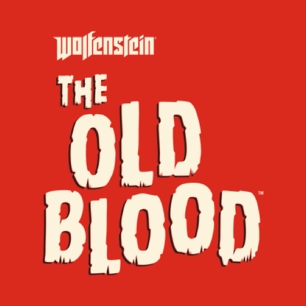
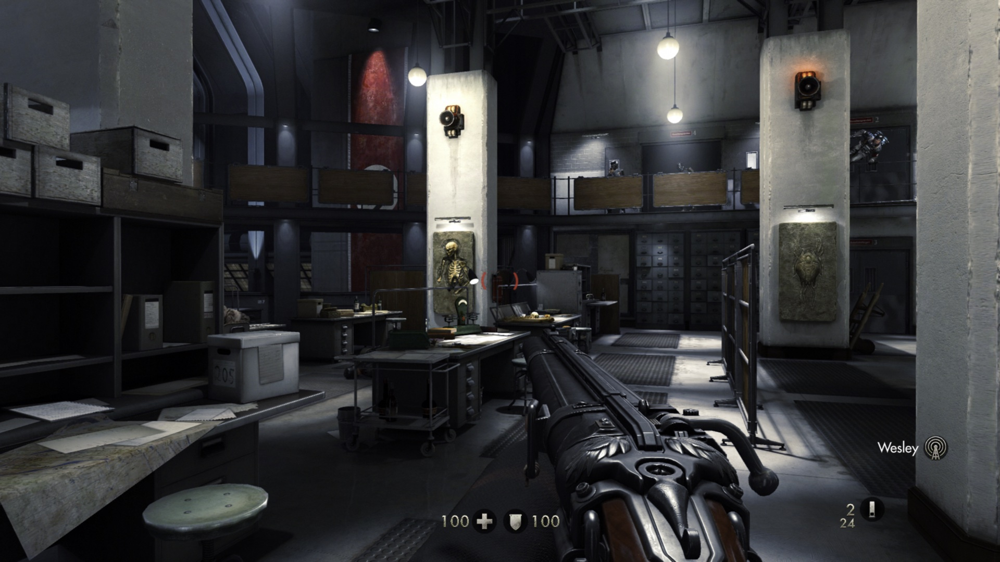

# Wolfenstein: The Old Blood Recomp

**Wolfenstein: The Old Blood Recomp** is a native Apple Silicon port of **Wolfenstein: The Old Blood**
(MachineGames, 2015), made by statically recompiling the original Windows release.

The Old Blood never had a Mac version. This project translates the game's own 64-bit Windows executable and its
code DLLs, function by function, into C and compiles them for arm64, so id Tech 5 runs natively on macOS with no
Wine, no Rosetta and no x86 emulation at run time. The engine and game code run unchanged. The parts that talked to
Windows (windows and input, files, threads, audio, networking, Steam) are replaced with native implementations, and
the game's OpenGL renderer runs on macOS's own OpenGL, which on Apple Silicon is built on Metal.

It is the sibling of [Wolfenstein-TNO-Recomp](https://github.com/NightSightProductions/Wolfenstein-TNO-Recomp): The
Old Blood is built on the same id Tech 5 branch as The New Order, so the two ports share almost everything.

This is an unofficial community project. It is not affiliated with or endorsed by MachineGames, id Software,
Bethesda or ZeniMax. **You need your own copy of the game**: none of the game's code or data files are included in
this repository.

## Playing on macOS

  1. Install the **Windows** version of **Wolfenstein: The Old Blood** through Steam, either in the Steam for Mac
     client or with Steam for Windows in [CrossOver](https://www.codeweavers.com/crossover). Make sure the game is
     fully downloaded and updated.
  2. Download `Wolfenstein-TOB-Recomp-macOS.dmg` from the [Releases](https://github.com/NightSightProductions/Wolfenstein-TOB-Recomp/releases) page.
  3. Open it and run **Install Wolfenstein Old Blood Recomp**. The installer finds your copy of the game, checks that
     it is the supported release, and builds the game on your Mac. The build takes about 5 minutes, needs about
     1.5 GB of temporary disk space, an internet connection and Apple's Command Line Tools (the installer offers to
     install them).
  4. Launch **Wolfenstein: The Old Blood** from your Applications folder.

Note: release builds are not notarized by Apple yet, so macOS blocks the installer the first time it is opened. To
allow it, go to **System Settings > Privacy & Security** and click **Open Anyway**.

To build from source instead, see [Build Instructions](#build-instructions).

Some things worth knowing:
  - Saved games go through **Steam Cloud**, shared with the Windows version in both directions with nothing to
    import, when the game is started from Steam with the **NightSight Recomp (NSR)** tool (see
    [Steam Play](#steam-play-optional-needs-notproton)). The Old Blood syncs its saves with Steam Auto-Cloud, which
    Steam for Mac maps into the game's compatibility prefix,
    `steamapps/compatdata/350080/pfx/drive_c/users/steamuser/Saved Games`, and syncs before launch and after exit;
    the game saves straight into that folder. Started without Steam, it uses the same folder, and Steam uploads the
    changes the next time it starts the game. Set `WOLF_LOCAL_SAVES=1` to keep saves in
    `~/Library/Application Support/wolfoldblood-recomp` instead.
  - The game data is read from your Steam installation, which is never modified.
  - With the Steam for Mac client running and logged in, the game signs in through the client's
    `libsteam_api.dylib`; without Steam, it runs offline.
  - The app contains code translated from your copy of the game. Don't share it; share this repository instead, so
    others build it from their own copy.

### Steam Play (optional, needs NotProton)

As with the other NightSight recomps, [NotProton](https://github.com/NotProtonNot/NotProton) lets the game's own
Steam library entry start the native app through NightSight Recomp (NSR). From a source build, run
`make steam-play` (pass `APP_PATH="/Applications/Wolfenstein The Old Blood.app"` for an installed app), restart
Steam, then choose **NightSight Recomp (NSR)** under **Wolfenstein: The Old Blood > Properties >
Compatibility > Force the use of a specific Steam Play compatibility tool**. Leave the game's Steam launch options
empty.

NSR's tool ID is `nsr_proton`: Steam for Mac maps a game's Auto-Cloud rules (here Windows' Saved Games) into its
compatibility prefix only when the tool's name contains "proton", and skips every rule otherwise. An install of
NSR from before that change (tool ID `nsr`) is moved over by `make steam-play`; with Steam closed, the games' Steam
settings are switched as well.

## How It Works

The port is built on [Recomp-Framework](https://github.com/NightSightProductions/Recomp-Framework),
NightSightProductions' static recompiler, included as the `framework/` submodule (clone with
`git clone --recursive`, or run `git submodule update --init`).

  - **The executable.** The Steam release's `WolfOldBlood_x64.exe` is wrapped in SteamStub v3.0 (the same variant as
    The New Order's): its code section is encrypted until the wrapper decrypts it at startup.
    `tools/unwrap_steamstub.py` does that decryption once, at build time, on your copy. The game still signs in
    through the real Steam client.
  - **Translation.** The framework's translator turns the executable and its two code DLLs (`superscriptx64.dll`,
    the script VM, and `bink2w64.dll`, the video codec) into C: about 48,000 functions that run against the original
    x86-64 register state, with guest memory at the addresses the game expects.
  - **Runtime.** The framework's runtime re-implements the Windows APIs the game imports, and its OpenGL layer runs
    WGL on macOS's OpenGL 4.1 core profile. No framework changes were needed for this game.
  - **This repository** holds what is specific to the game:
    - `src/game.c`: the game's settings for the runtime (executable, folders, Steam app ID, bundled image, GL
      extensions);
    - `src/cloud_wolf.c`: Steam Cloud saves, by pointing the game's Saved Games folder at the compatibility prefix Steam syncs;
    - `src/imports_wolf.c`: a CUDA runtime with no devices. Unlike The New Order, The Old Blood links the whole CUDA
      virtual-texture transcode path (41 `cudart` functions) and registers its kernels from static initializers;
      with no CUDA device the engine uses its CPU transcoder;
    - `src/native_wolf.c`: native replacements for routines in the executable (none are needed so far: The Old
      Blood's CRT has no x87 `fmodf`);
    - `tools/unwrap_steamstub.py`, `scripts/build.sh` and the installer in `setup/macos`.

## License

The code in this repository is licensed under the terms of the **MIT License**. You can find the entire license in
the [LICENSE](LICENSE) file.

**Wolfenstein: The Old Blood**, its executable, DLLs and data remain the property of their respective owners. The C
code that the build generates from the game's code (`gen/`, `gen_superscript/`, `gen_bink/`), the unwrapped
executable and the built app are derived from the game and **must not be redistributed**; the repository is set up
so that they are never committed.

The Wolfenstein: The Old Blood logo (from the game's Steam library artwork) and screenshots are shown only to identify
the game; the logo is a trademark of its respective owners.

## Features

  - Native Apple Silicon (arm64) build of the original Windows release, with the original engine code
  - OpenGL rendering on macOS's OpenGL (Metal), at the display's native resolution
  - Steam Cloud saves shared with the Windows version
  - Keyboard, mouse and game controllers (Xbox, PlayStation, Switch Pro and MFi through Apple's GameController)
  - A `.app` bundle that finds your Steam installation by itself

## Support and Feedback

  * [GitHub Issue Tracker](https://github.com/NightSightProductions/Wolfenstein-TOB-Recomp/issues)
  * [Discord](https://discord.gg/GKacpbpyQb)

When reporting a problem, include `~/Library/Logs/WolfOldBlood-recomp.log` from the session where it happened.

## System Requirements

| | |
|---|---|
| macOS | 26 or later, Apple Silicon (M1 or later). Intel Macs are not supported. |
| Game | Wolfenstein: The Old Blood, the Windows version from Steam |
| Tools | Xcode Command Line Tools (`xcode-select --install`), with Python 3.9 or later |

The build downloads two Python packages, [Capstone](https://www.capstone-engine.org) 5.0.6 and
[LIEF](https://lief.re) 0.16.6, into a local `.venv` folder.

## Build Instructions

  1. Clone the repository with its submodule:

     `git clone --recursive https://github.com/NightSightProductions/Wolfenstein-TOB-Recomp.git`

  2. Build the game from your copy. The usual Steam locations are searched if no path is given:

     `scripts/build.sh "/path/to/steamapps/common/Wolfenstein The Old Blood"`

     This verifies the game files against the supported release, unwraps the executable, translates the code
     (`make gen gen-dll gen-bink`), compiles it (`make boot`) and creates `build/Wolfenstein The Old Blood.app`
     (`make app`).

  3. Run it:

     `open "build/Wolfenstein The Old Blood.app"`

     or from a terminal, with the log on screen:

     `./build/boot orig.exe "/path/to/steamapps/common/Wolfenstein The Old Blood"`

### Debugging Options

These environment variables are read by the game. For the app, pass them with
`open --env NAME=value "build/Wolfenstein The Old Blood.app"`.

| Variable | Effect |
|----------|--------|
| `WOLF_STEAM_OFFLINE=1` | Do not connect to Steam |
| `WOLF_LOCAL_SAVES=1` | Keep saves on this Mac instead of in Steam Cloud's folder |
| `RT_FPS=1` | Log the frame rate and worst frame time every 5 seconds |
| `RT_GL_CHECK=1` | Check for an OpenGL error after every call |
| `RT_GL_SCREENSHOT=n`, `RT_GL_SCREENSHOT_FILE=path.ppm` | Save the image of frame *n* |
| `RT_WATCHDOG=secs` | Print what every guest thread is doing every few seconds |
| `RT_STRICT=1` | Stop on any call into a Windows function that is not implemented, instead of logging it |

## Acknowledgements

  * [Capstone](https://www.capstone-engine.org) and [LIEF](https://lief.re), used by the translator
  * [Steamless](https://github.com/atom0s/Steamless), whose documentation of the SteamStub formats informed the unwrap tool
